# How a change gets from your codespace to the live site

Everyone works on their own copy. GitHub is the only place you share. Nothing a team member writes joins
the shared code without a pull request, a green `verify` check and a yes from a teammate.

This page explains the git side in plain words. [`CONTRIBUTING.md`](../CONTRIBUTING.md) has the full
workflow and the rules, and [`docs/DEV.md`](DEV.md) has the codespace setup. New words are explained in
[The words, in plain English](#the-words-in-plain-english) near the end.

## The whole trip

```mermaid
flowchart LR
  subgraph You["Your codespace: only you see it"]
    A["Step 1: Get the latest main"] --> B["Step 2: Make a branch"] --> C["Step 3: Build and test with Claude Code"] --> D["Step 4: Commit"]
  end
  subgraph Hub["GitHub: the whole team sees it"]
    E["Step 5: Open a pull request"] --> F["Step 6: verify passes and a teammate approves"] --> G["Step 7: Squash and merge into main"]
  end
  subgraph Servers["The servers: they update on their own"]
    H["Staging updates within minutes"] --> I["Product owner publishes a release on Wednesday"] --> J["Live site updates"]
  end
  D -->|push| E
  G -->|CI passes on main| H
```

## Three places your code can be

Most confusion comes from mixing these up.

| Where | Who sees it | What it is |
| --- | --- | --- |
| Your codespace | Only you | A computer in the cloud with your own copy of the repo. Until you push, your work exists only here. |
| GitHub | The whole team, and the public | The shared copy: branches, pull requests, reviews and the CI checks. |
| The two websites | Everyone | [Staging](https://staging-77-112-161-54.sslip.io) runs the newest `main` that passed CI. [Live](https://hr-77-112-161-54.sslip.io) runs the last release. Both deploy on their own; team members never deploy by hand. |

Codespaces never talk to each other. Your teammates cannot see your work until you push it, and you do not
get their merged work until you pull it.

## Your loop, one issue at a time

Work in a new terminal in your codespace (menu > Terminal > New Terminal), because the first one runs the
app. Type `claude` there to start Claude Code.

Claude Code can do every git step for you. Ask it in plain words, then read what it did. The commands are
here so you know what is happening. The examples use issue #4, "Password reset by email"; use your own
issue's number and name.

1. **Start from the latest main.** Your codespace does not update itself when teammates merge, so do this
   first, every time.
   - Say to Claude Code: "Switch to main and get the latest."
   - Or type: `git switch main && git pull`
2. **Make a branch for one issue.** Name it with your workstream's prefix: `s1/` security and team logins,
   `s2/` HR depth and integrations, `s3/` product, access and AI, `team/` shared work.
   - Say to Claude Code: "Make a branch called s1/password-reset for issue #4."
   - Or type: `git switch -c s1/password-reset`
3. **Plan, build and test.** Ask for a plan first: press Shift+Tab until the status bar shows "plan mode
   on". Then let Claude write the code and its tests, and read every change it makes. `npm run check` is
   the quick check while you work. Before you open the pull request, run `npm run verify`, which runs
   almost everything the `verify` check on GitHub runs. After a change in `server/deploy/`, also run
   `npm run test:deploy`.
4. **Commit.** A commit is a save point with a message. Make as many as you like on your branch.
   - Say to Claude Code: "Commit this with a clear message."
   - Or type: `git add -A`, then `git commit -m "Password reset by email"`
5. **Push and open a pull request.** Push uploads your branch to GitHub. The pull request asks for it to
   be added to `main`. Fill in the template and write `Closes #4` so the issue closes when it merges.
   - Say to Claude Code: "Push my branch and open a pull request that closes #4, using the template."
   - Or type: `git push -u origin HEAD`, then `gh pr create`
6. **Get it green and approved.** CI runs by itself and takes a few minutes. At the bottom of the pull
   request, a green tick next to `verify` means it passed; on a red cross, click **Details** to see why.
   To ask for a review, pick a teammate under **Reviewers** on the right. To answer a comment, change the
   code on the same branch, commit and push again (the pull request updates itself), or reply if you
   disagree. Then click **Resolve conversation** under it.
7. **Squash and merge, then check staging.** When the **Squash and merge** button at the bottom of the
   pull request turns green, click it, check the commit title, then click **Confirm squash and merge**.
   GitHub deletes the branch on GitHub; your codespace keeps its copy. CI then runs once more on `main`,
   and within minutes of it passing the change is on staging. Go back to step 1 for the next issue.

## Reviewing a teammate's pull request

Review within two days. Run the change, not just read it.

1. Check out their branch and try it: `gh pr checkout 29` (the pull request's number). `npm run stack`
   runs the app with their change.
2. On GitHub, open the pull request and click the **Files changed** tab.
3. To comment on a line, hover over it and click the blue **+**. **Start a review** collects several
   comments into one.
4. Click **Review changes** (some layouts call it **Submit review**), choose one, then click
   **Submit review**:
   - **Approve**: it is ready to merge.
   - **Request changes**: it needs fixes first. This is normal, not a judgment.
   - **Comment**: feedback only, no decision.

Or approve from the terminal: `gh pr review 29 --approve`. You cannot approve your own pull request. What to
look for is in `CONTRIBUTING.md`, "Reviewing a teammate's pull request".

## What squash means

A branch often collects many small commits: "first try", "fix typo", "fix the test". **Squash and merge**
combines all of them into one commit when the branch joins `main`, so `main` gets one entry per pull
request. When the pull request has two or more commits, GitHub names that commit after the pull request,
such as "Comp and plan: a read-only Benefits tab (#29)", and lists the small commits' messages under it.
With only one commit, it uses that commit's message. You can edit the title before you confirm. Squash is
the only merge option this repo allows.

After a squash, `main` has your change as one new commit, not your branch's small commits, so git cannot
tell that your old branch is already merged. A new pull request from it would show the old commits again
and can hit conflicts. Start the next change from a fresh `main` (step 1).

## Why the Merge button is grey

These rules are switched on for `main`. If you cannot merge, one of these is usually the reason.

- **Team members cannot push straight to `main`.** Every change goes through a pull request. If you try,
  GitHub refuses the push, so nothing breaks.
- **The `verify` check must pass.** It passes only when all four CI jobs pass: typecheck and builds, the
  unit tests, the server tests and journeys, and the deploy kit's tests.
- **One teammate must approve.** You cannot approve your own pull request.
- **New commits can clear an approval**, including the one **Update branch** adds. If the approval
  disappears, ask for a fresh one.
- **Every review conversation must be resolved.**
- **Your branch must be up to date with `main`.** If GitHub says the branch is out of date, click
  **Update branch** in the box at the bottom of the pull request. Wait for CI to pass again, and if the
  approval was cleared, ask for a fresh one. Updating before you ask for a review saves your reviewer a
  second look.
- **No merge conflicts.** If GitHub says the branch has conflicts, see "I have a merge conflict" below.
- **Protected files also need the product owner.** A pull request that touches database migrations
  (`server/sql/`), the deploy kit (`server/deploy/`), `package.json`, `package-lock.json`, `CLAUDE.md`,
  `.claude/`, `.github/`, `.devcontainer/`, `scripts/dev/` or `SECURITY.md` also waits for the product
  owner, who reviews those in the Wednesday session (`.github/CODEOWNERS`).

## Who does what

| Who | Does |
| --- | --- |
| Team members | Pick an issue and assign it to yourself, branch, build with Claude Code, open pull requests, review each other's within two days, and merge your own once it is approved. |
| Product owner | One hour a week, the Wednesday session: sets priorities, reviews pull requests that touch protected files, and publishes the release that updates the live site. |
| Advisor | Joins the release reviews in weeks 2, 4 and 6 and the final review in week 8. |
| CI | Runs four jobs (typecheck and builds, unit tests, server tests and journeys, deploy kit tests) on every pull request and every push to `main`. The pull request lists all four plus `verify`, the one required check, which passes only when the other four did. |
| The servers | Staging deploys each commit on `main` once CI passes. Live deploys each published release, and backs up the database first when the release has new migrations. |

## The words, in plain English

| Word | Meaning |
| --- | --- |
| Repo | The project folder with its full history. Ours lives on GitHub. |
| `main` | The shared, official version of the code. Staging runs it. |
| Branch | A named line of work that starts from `main`, so one change can grow without disturbing anyone. |
| Commit | A save point on a branch, with a message saying what changed. |
| Push | Upload your branch's commits from your codespace to GitHub. |
| Pull | Download the newest commits from GitHub into your codespace. It has nothing to do with a pull request. |
| Pull request (PR) | A page on GitHub asking to add your branch to `main`. The review and the checks happen there. |
| CI and `verify` | Robots that run the checks and tests on every pull request. `verify` is the one check that sums them up. |
| Review and approve | A teammate reads and runs your change, then approves it or asks for changes. |
| Squash and merge | Adds your whole branch to `main` as one commit (see "What squash means"). |
| Merge conflict | You and someone else changed the same lines. Git needs a person to choose. |
| Force-push | Overwrite a branch on GitHub with your copy, throwing away commits that are only on GitHub. |
| Release | A version the product owner publishes on GitHub. Publishing it updates the live site. |
| Codespace | Your personal cloud computer for this repo. Each person has their own. |
| Issue | A to-do on GitHub, with a "Done when" that says when it is finished. |

## When something looks wrong

**My codespace doesn't have my teammate's change.** Codespaces never sync with each other. Their change
reached GitHub when it merged; you still need to download it. On `main`: `git switch main && git pull`. In
the middle of your own branch, ask Claude Code: "Bring the latest main into my branch."

**GitHub says my branch is out of date.** Someone merged since you branched. Push your latest commits
first. Then click **Update branch** (the plain button, not "Update with rebase"), and CI runs again. Before
you change anything else in your codespace, run `git pull` so you have the updated branch too. If git says
the branches have diverged, ask Claude Code to merge the GitHub copy of your branch into yours. Never
force-push.

**My approval disappeared.** New commits on the branch cleared it: yours, or the one **Update branch**
made. Ask the same teammate to look again.

**I have a merge conflict.** Ask Claude Code: "Merge main into my branch, resolve the conflicts, and
explain each one to me." Check that it kept both people's work, run `npm run check`, then commit and push.

**I made commits on `main` by mistake.** Nothing is broken, because GitHub refuses the push. Ask Claude
Code: "Move my new commits off main onto a new branch called s1/my-change, and put main back to match
GitHub."

**My change is merged but the live site doesn't show it.** That is expected. Merged work goes to staging
within minutes, once CI passes on `main`. The live site changes only when the product owner publishes a
release, once a week at the end of the Wednesday session.

**Can my work get lost?** Anything you pushed is safe on GitHub. Anything you have not pushed lives only in
your codespace, and GitHub deletes a codespace that stays stopped for 30 days (the default), even if it
holds work you have not pushed. Push every time you stop working, even unfinished work. You can open the
pull request as a draft: ask Claude Code for a draft pull request.

**Two of us want to work on the same thing.** Split it into two issues, or share one branch: before you
change anything, run `git pull` to get your teammate's latest commits. Never force-push a branch someone
else is using.

Stuck for more than an hour? Write in the issue what you tried and what happened, then bring it to the
Wednesday session.
